<div align="center">
   <div style="display: flex;padding-block:40px;margin-bottom:20px;background-color:#1f1f1f">
      <picture>
         <source media="(prefers-color-scheme: dark)" srcset="../logos/logo_dark.png">
         <source media="(prefers-color-scheme: light)" srcset="../logos/logo_light.png">
         
      </picture>
   </div>
</div>

# [Resume Builder](https://resume.pivi.dev/)

Resume Builder is a web app for writing and styling a resume. It has 15 templates, 55 colour palettes, and 22 Google Fonts, plus dark mode and internationalization. You can import and export the resume data as JSON and generate a PDF from the app. It runs at <https://resume.pivi.dev/>.

       

## Getting Started

```bash
git clone https://github.com/thisispivi/Resume.git
cd resume
pnpm i
pnpm dev
```

## Deployment

The Release workflow builds this folder and deploys it to GitHub Pages when a new version reaches `main`. See the [root README](../README.md#deployment).

## Project Structure

```text
.
├── logos     Assets used in the app
└── resume    The React app for Resume Builder
```
